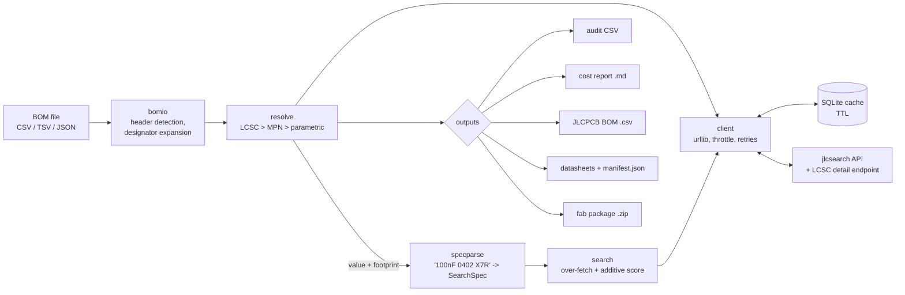

# jlcfind

A zero-dependency Python CLI that searches the JLCPCB/LCSC parts library, resolves a
BOM to concrete LCSC part numbers with an auditable decision per line, estimates
assembly cost at the right price break, downloads datasheets, and bundles a fab
package.

## Why

Sourcing a board for JLCPCB assembly is mostly bookkeeping: map every BOM line to an
LCSC code, prefer Basic/Preferred parts (no per-part setup fee), read the price at the
quantity you actually order, and notice when a line is out of stock or matched to the
wrong thing. The web UI does this one part at a time. `jlcfind` does it for the whole
BOM, deterministically, and tells you *why* it picked each part and which lines it is
not confident about.

## Quickstart

Requires Python 3.11+. No runtime dependencies (`rich` is optional, for nicer tables).

```bash
git clone https://github.com/Tommycode3/jlcfind && cd jlcfind
pipx install .                 # or: pip install .   -> provides the `jlcfind` command
# without installing:
PYTHONPATH=src python3 -m jlcfind --help
```

```bash
jlcfind search "100nF 0402 X7R 16V"            # parametric search, ranked + reasons
jlcfind part C2128 --json                      # one part: tier, stock, price breaks, datasheet
jlcfind resolve examples/sample_bom.csv        # BOM -> audit CSV (status per line)
jlcfind cost examples/sample_bom.csv --qty 50 --out cost.md
jlcfind bom examples/sample_bom.csv --out jlc_bom.csv   # JLCPCB assembly BOM format
jlcfind datasheets examples/sample_bom.csv     # PDFs + manifest.json
jlcfind package examples/sample_bom.csv --qty 50 \
    --gerbers ./gerbers --cpl ./cpl.csv --out board_fab.zip
```

Most commands accept `--json` and `--fresh` (bypass cache). Configuration:

```bash
jlcfind config --set extended_part_fee_usd=3 default_board_qty=10 prefer_basic=true
jlcfind cache --clear
```

Config and cache live in `~/.jlcfind/` (override with `JLCFIND_HOME`).

Tests (offline, no network):

```bash
pip install pytest && python3 -m pytest
```

## How it works



**BOM ingestion.** Column headers are normalised and matched against synonyms used by
KiCad, JLCPCB and generic exports (`LCSC Part #`, `Manufacturer Part Number`,
`Comment`/`Value`, `Footprint`/`Package`, ...). Designator lists are split on
`,`/`;`/whitespace and simple ranges (`R1-R4`) are expanded; quantity defaults to the
designator count.

**Resolution order** (per line, first match wins):

1. LCSC code -> exact code match: `resolved`. Non-exact hit: `ambiguous`.
2. MPN -> exact (case-insensitive) MPN match: `resolved`. Otherwise closest hit: `ambiguous`.
3. Value + footprint -> parametric search (below). The top candidate is `resolved` only
   if it is Basic/Preferred **and** its package contains the requested package **and**
   the requested value token appears in its MPN or description. Anything else is
   `ambiguous` with a note saying what to review.

**Spec parsing.** Free text like `4k7 0603 1%` or `100nF 0402 X7R 16V` is tokenised:
packages via a regex over common SMD/THT names, values via SI prefixes
($\mathrm{p}=10^{-12}$ ... $\mathrm{G}=10^{9}$) and resistor code notation
(`4k7` $= 4.7\cdot10^{3}\,\Omega$, `1R0` $=1\,\Omega$), plus dielectric, tolerance and
voltage tokens. The unit determines the component type, which selects a category hint
for the API query.

**Ranking.** Search over-fetches (60 rows by default), drops parts below `min_stock`,
then sorts by an additive, fully explainable score. For a part with tier $t$, stock
$s$ and lowest unit price $p$ (USD):

$$
S = T(t) + P + V + \sigma(s) + \pi(p)
$$

$$
T = \begin{cases}1000 & \text{Basic}\\ 650 & \text{Preferred}\\ 0 & \text{Extended}\end{cases}
\qquad
P = \begin{cases}+220 & \text{package equal}\\ +120 & \text{package contains request}\\ -150 & \text{mismatch}\end{cases}
\qquad
V = \begin{cases}+160 & \text{value token found}\\ 0 & \text{otherwise}\end{cases}
$$

$$
\sigma(s) = \begin{cases}\min\!\big(20\log_{10}(s+1),\ 120\big) & s>0\\ -500 & s=0\end{cases}
\qquad
\pi(p) = \max\!\big(0,\ 60 - 12\log_{10}(1000\,p+1)\big)
$$

The tier weights encode the economics: an Extended part costs a one-time setup fee,
which for small runs dwarfs any per-unit price difference. Stock and price terms are
logarithmic and capped so they break ties without overriding tier or package. Every
term that fires is emitted as a human-readable reason (`search` prints them; `resolve`
writes them to the audit CSV).

**Cost model.** For $N$ boards and BOM line $i$ with $q_i$ parts per board, the order
quantity is $Q_i = q_i N$ and the unit price $u_i(Q_i)$ is read from the price-break
interval that contains $Q_i$ (below the first break: the first break's price). With
$E$ the set of distinct Extended parts and $F$ the per-part setup fee (default 3 USD):

$$
C_{\text{total}} = \sum_i u_i(Q_i)\,Q_i \;+\; F\,|E|,
\qquad
C_{\text{board}} = \frac{C_{\text{total}}}{N}
$$

Lines flagged `ambiguous` are still costed (and counted); `unresolved` lines are
excluded. A stock warning is raised when $\text{stock}_i < Q_i$. Board fabrication,
assembly labour and shipping are **not** modelled: this is a parts + setup-fee estimate.

**Network layer.** stdlib `urllib` only. Requests are throttled (0.5 s minimum spacing),
retried with linear backoff, and cached in SQLite keyed by URL: 24 h TTL for
search/stock/price, 30 days for datasheet URLs (from the LCSC product-detail endpoint).

## Key design decisions

| Decision | Why | Tradeoff |
|---|---|---|
| Stdlib only (`urllib`, `sqlite3`, `argparse`, `csv`) | Installs anywhere, importable as a library by other tools, nothing to audit | More hand-written code; plain tables unless `rich` is present |
| Additive hand-tuned score instead of a learned ranker | Every pick is explainable and reproducible; easy to reason about | Weights are heuristics, not fitted to data |
| Conservative status: `resolved` needs tier + package + value agreement | A wrong part on an assembled board is far more expensive than a manual review | More lines land in `ambiguous` |
| Free community API (jlcsearch) instead of official/paid APIs | No keys, no OAuth, zero setup | No SLA; result quality depends on upstream (see below) |
| CAD-agnostic: works from a BOM file, bundles (does not generate) gerbers/CPL | Same tool for KiCad, Altium, EasyEDA exports | CPL check is a header sanity check only |

## Status and limitations

- Version 0.1.0. 23 offline unit tests cover spec parsing, BOM I/O, price-break
  parsing, cost aggregation and resolution status; network code is exercised manually,
  not in CI.
- **Upstream search quality is the main limitation.** On 2026-10-30 jlcsearch returned
  unrelated parts for several queries (e.g. an MPN search for `STM32F103C8T6` returned an
  LDO regulator; `10k 0402` returned an inductor). `jlcfind` flags these lines as
  `ambiguous` rather than `resolved`, but it cannot produce a correct part the API does
  not return. Exact LCSC-code lookups were reliable in the same test.
- Value matching is a substring check on the MPN/description, not a numeric comparison:
  `100nF` will not match a part described as `0.1uF`, and `1k` can match `11k`.
- Fees reflect JLCPCB's Basic/Preferred/Extended policy as encoded in the default config;
  check current pricing on jlcpcb.com before ordering.
- The LCSC product-detail endpoint is undocumented and may change; datasheet download
  degrades gracefully (empty URL) if it does.

## License

MIT. See [LICENSE](LICENSE).
